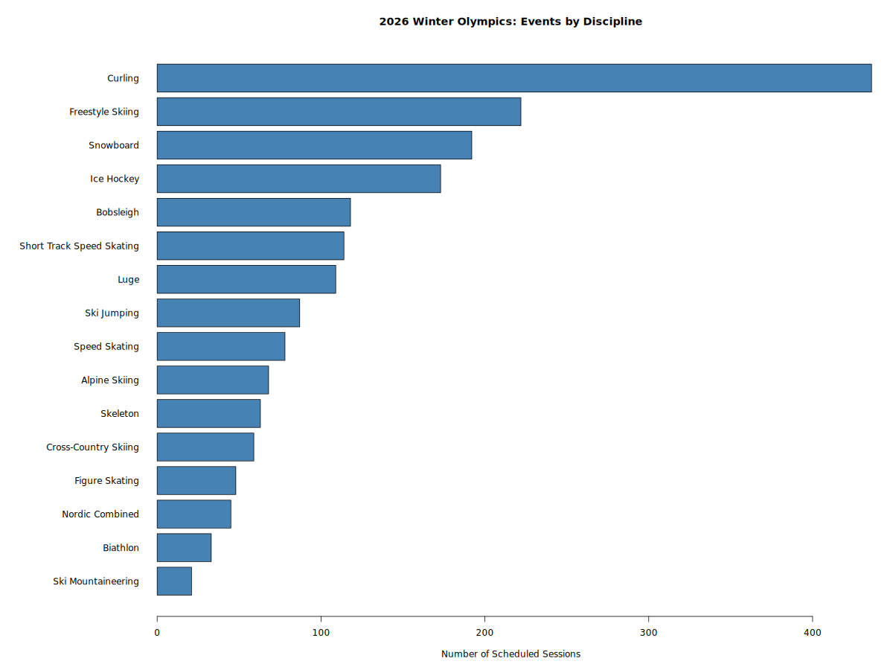

# Winter Olympics 2026: Events by Discipline

## Research Question

Which sport disciplines have the most events scheduled?

## Methodology

We used the 2026 Winter Olympics schedule dataset
from TidyTuesday, containing 1,866 scheduled sessions.

Using R, we grouped the data by discipline_name
and counted the number of scheduled sessions for
each sport.

## Results

Curling has the most scheduled sessions (436),
followed by Freestyle Skiing (222) and
Snowboard (192).

## Conclusion

Curling has significantly more scheduled sessions
than any other discipline in the dataset.

However, these counts include both competitions
and training sessions, rather than only medal events.

## Data Source

[TidyTuesday - 2026 Winter Olympics](https://github.com/rfordatascience/tidytuesday/tree/main/data/2026/2026-02-10)