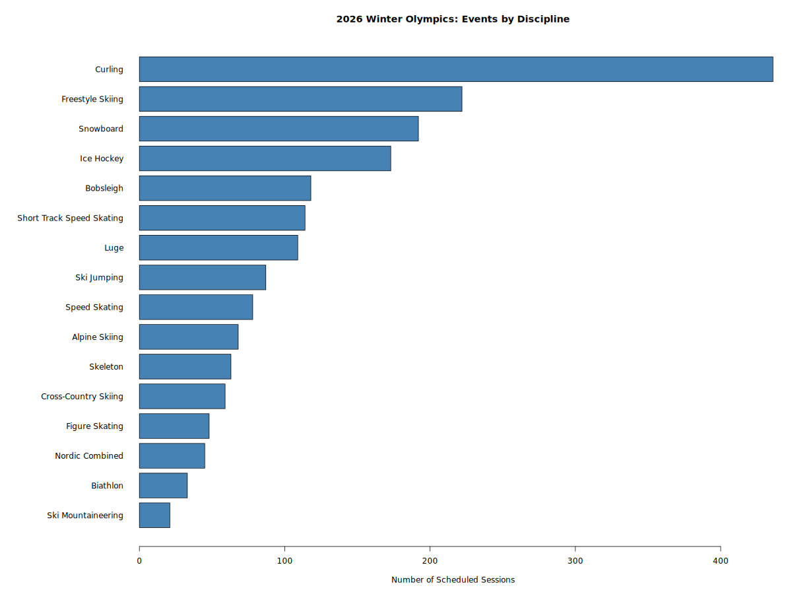
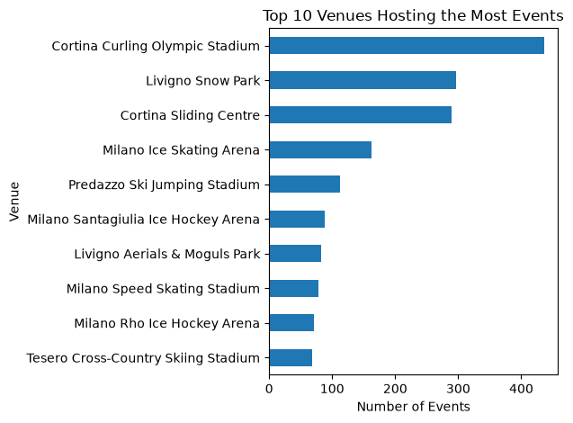

## Research Questions & Dataset

**Dataset:** 2026 Winter Olympics Schedule

- Source: TidyTuesday (February 10, 2026)
- Total: 1,866 scheduled sessions
- Location: Milano-Cortina, Italy
- Includes competitions and training sessions

**Our Research Questions:**

1. Which sport disciplines have the most events scheduled?
2. Which venues host the most events?

## Events by Discipline

{width="90%"}

## Key Findings

**Which sport disciplines have the most events scheduled?**

- Curling has the most scheduled sessions (436).
- Freestyle Skiing ranks second (222).
- Snowboard ranks third (192).

**Conclusion:**

Curling has substantially more scheduled sessions
than any other discipline.

*Note: Counts include both competitions and training sessions.*

## Events by Venue

{width="90%"}

## Venue Analysis

**Which venues host the most events?**

**Top 3 Venues:**

1. Cortina Curling Olympic Stadium — 436 sessions
2. Livigno Snow Park — 297 sessions
3. Cortina Sliding Centre — 290 sessions

**Conclusion:**

Cortina Curling Olympic Stadium hosts the most
scheduled sessions among all Olympic venues.

*Note: Counts include competitions and training sessions.*